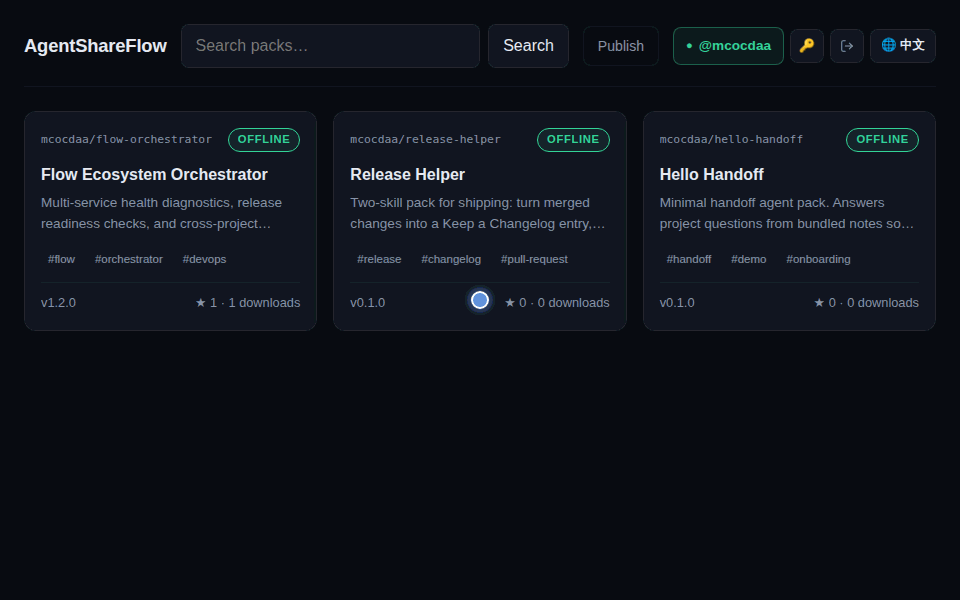

<div align="center">

# AgentShareFlow

**面向 AI Agent Pack 的开放注册表、沙箱演练场与实时会话交接网络。**

[](https://github.com/mcocdaa)
[](https://github.com/mcocdaa/AgentShareFlow/actions/workflows/ci.yml)
[](https://github.com/mcocdaa/AgentShareFlow/releases)
[](https://www.typescriptlang.org/)
[](Dockerfile)
[](LICENSE)

[English](README.md) · [简体中文](README_CN.md)



</div>

---

## ✨ 核心特性

- **多宿主 Agent Pack 打包与一键安装**：将 Skill、系统提示词与 MCP 服务配置统一打包，一条命令即可安装到 **Claude Code**、**Codex**、**OpenCode**、**OpenClaw** 与 **Hermes**，全面兼容 [agentskills.io](https://agentskills.io) 开放规范。
- **内置安全扫描与 Lockfile 完整性校验**：在 `push`/`install`/`update` 全链路静态扫描提示词注入与高危命令，结合 Ed25519 密钥签名（`agentshare keygen` / `push --sign`）与 Lockfile 保障供应链安全。
- **交互式沙箱演练场与对称认证**：在浏览器演练场（`#/playground`）内直接在线试用已发布的 Agent Pack，并在 WebUI 与 CLI 间共享对称的 Bearer Token（`AGENTSHARE_TOKENS`）或 OIDC 认证体系。
- **实时会话交接与 A2A 隧道中继**：通过 `/share` 生成实时分享链接（按访客独立 Fork 只读上下文），或使用 `agentshare expose` 将本地 A2A Agent 经出站隧道安全挂载至公网，无需暴露入站端口。
- **内置 MCP Server 与联邦生态互通**：执行 `agentshare serve --mcp` 即可让任意支持 MCP 的智能体自主搜索、审查并安装 Agent Pack，同时支持从 ClawHub、Smithery 与 `skills.sh` 一键导入。
- **跨工具任务交接包（Handoff Bundle）**：支持在不同 Agent 宿主间导出、续做并回流完整会话上下文、代码变更集与可验证交付物（`handoff/v0` 与 `submission/v0`）。

---

## 🚀 快速开始

### 方式一：Docker Compose（推荐 — 单条命令启动）

一键启动内置 SQLite 存储、API 注册表与前端 Web 界面的完整服务：

```bash
AGENTSHARE_TOKENS='devtoken:myowner' docker compose up -d --build
```

启动后在浏览器打开 **`http://localhost:8787`** 即可访问注册表、沙箱演练场与在线发布页。

### 方式二：源码构建运行（`pnpm`）

> **环境要求**：Node.js >= 22（需内置 `node:sqlite` 支持）及 `pnpm` >= 9。

```bash
pnpm install && pnpm build
AGENTSHARE_TOKENS='devtoken:myowner' pnpm registry   # 启动 API 与 Web 中继服务（默认 http://localhost:8787）
pnpm web                                             # 可选：启动 Vite 前端开发服务（http://localhost:5173）
node packages/cli/dist/index.js login --registry http://localhost:8787 --token devtoken --owner myowner
node packages/cli/dist/index.js push examples/hello-handoff
```

---

## 🤖 CLI 与 MCP 接入

### 核心 CLI 工作流

```bash
# 1. 登录并保存 Registry 凭证
agentshare login --registry http://localhost:8787 --token devtoken --owner myowner

# 2. 校验、安全扫描并发布 Agent Pack
agentshare push examples/hello-handoff

# 3. 搜索与查看包元数据
agentshare search handoff
agentshare info myowner/hello-handoff

# 4. 安装到目标宿主（claude | codex | opencode | openclaw | hermes | agents）
agentshare install myowner/hello-handoff --target claude
```

### MCP Server 配置（`agentshare serve --mcp`）

向你的 AI 编程助手直接暴露 `agentshare_search`、`agentshare_info` 与 `agentshare_install` 三个工具：

```json
{
  "mcpServers": {
    "agentshare": {
      "command": "npx",
      "args": ["-y", "@agentshare/cli", "serve", "--mcp", "--registry", "http://localhost:8787"],
      "env": {
        "AGENTSHARE_TOKEN": "devtoken"
      }
    }
  }
}
```

### 外部生态导入与本地 Agent 隧道暴露

```bash
# 从外部注册表导入技能或 MCP 服务并转换为标准 Agent Pack
agentshare import clawhub steipete/weather --out ./weather
agentshare import smithery upstash/context7-mcp --out ./context7

# 将本地运行的 A2A Agent 经出站隧道挂载到中继站（无需公网入站端口）
agentshare expose --a2a http://127.0.0.1:9999 --title "My Local Agent"
```

---

## 📚 文档与架构

### 工作区目录结构

| 目录 | 包名 / 角色 | 说明 |
| :--- | :--- | :--- |
| `packages/core` | `@agentshare/core` | Zod 契约校验（`agent.json`）、打包/解包引擎、安全扫描器、A2A 与分享隧道协议 |
| `packages/cli` | `@agentshare/cli` | `agentshare` 命令行工具（`login`、`push`、`search`、`install`、`update`、`import`、`expose`、`serve --mcp`） |
| `packages/registry` | `@agentshare/registry` | Hono + `node:sqlite` 服务端：Packs API、沙箱演练场、分享隧道中枢、A2A Facade |
| `packages/web` | `@agentshare/web` | React + Vite Web 前端：包浏览、交互式演练场、网页发布页与实时分享对话页 |
| `packages/dsh-plugin` | `dsh-agentshare` | DeepSeek Harness 插件，提供 `/share`、`/shares` 与 `/unshare` 实时会话分享指令 |
| `examples/` | 示例包 | 开箱即用的单技能（`hello-handoff`）与多技能（`multi-skill`）示例 Agent Pack |

### 核心规范与设计文档

- **[文档索引](docs/README.md)** — 架构文档、路线图与研究白皮书总览。
- **[Agent Pack 规范 v0](docs/spec/agent-pack.md)** — `agent.json` 字段定义、打包模式、安全扫描规则与各宿主安装路径映射。
- **[Registry HTTP API 规范 v0](docs/spec/registry-api.md)** — 包发布/搜索/下载、实时会话分享、WebSocket 隧道与 SSE 事件接口契约。
- **[M1 在线交接设计文档](docs/design/m1-online-handoff.md)** — 访客只读会话 Fork 隔离与出站隧道中继设计说明。

---

## 📄 开源协议

本项目基于 [MIT License](LICENSE) 开源。
